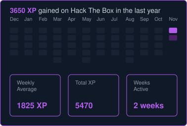

<h1>HTB Info</h1>

  

    

       <code> 🟩 Hack The Box </code> <code> :: </code> <code> <b>Level</b>   </code> <code> << </code> <code> [spoiler] </code>
    

    
  
  

  

    

       <code> 🟪 Hack The Box </code> <code> :: </code> <code> <b>HeatMap</b> </code> <code> << </code> <code> [spoiler] </code>
    

     
    
  

<h1>Stack Info</h1>

  

    

       <code> <b>🐧 Environment</b>  </code> <code> :: </code> <code> <b>Tools</b>   </code> <code> << </code> <code> [spoiler] </code>
    

     
      
      
      
      
      
      
      
      
  

  

    

       <code> <b>💻 Frontend</b>     </code> <code> :: </code> <code> <b>Tech</b>    </code> <code> << </code> <code> [spoiler] </code>
    

    
    
    
    
    
    
    
    
    
    
    
    
    
    
    
    
    
    
    
    
  

  

    

       <code> <b>⚙️ Backend</b>      </code> <code> :: </code> <code> <b>Core</b>    </code> <code> << </code> <code> [spoiler] </code>
    

     
      
      
      
      
      
      
      
      
  

  

    

       <code> <b>♾️ DevOps</b>       </code> <code> :: </code> <code> <b>CI/CD</b>   </code> <code> << </code> <code> [spoiler] </code>
    

     
      
      
      
  

  

    

       <code> <b>🧰 Tools</b>        </code> <code> :: </code> <code> <b>Main</b>    </code> <code> << </code> <code> [spoiler] </code>
    

     
      
      
      
  

  

    

       <code> <b>🧠 AI</b>           </code> <code> :: </code> <code> <b>Models</b>  </code> <code> << </code> <code> [spoiler] </code>
    

     
      
      
      
  

<!-- 
 -->
